# Tablero de control para un outlet de zapatillas

Tablero de control (dashboard) web para una cadena de outlets de zapatillas con
varias sucursales, creado con **React**, **ASP.NET Core** y **PostgreSQL** para
la materia **Bases de Datos Aplicada**.

## Contenido

- **Documento de la primera entrega** con el DER y el diccionario de datos:
  **`docs/Entrega 1 - Leonel Blumberg y Luciano Migoni.docx`**.
- **Diagrama entidad-relación** (Lucidchart) en **`docs/img/der.png`**.
- **Frontend** en **`client/`**: inicio de sesión, registro y tablero.
- **Backend** en **`server/`**: API de autenticación con token JWT.
- **Base de datos** en **`server/base de datos/`**: scripts SQL de creación de
  las 10 tablas y de siembra de usuarios.
- **Mockups** (Figma) en **`docs/img/mockups/`**: semaforización, drill down /
  drill up (Sucursal › Marca › Modelo › Detalle) y tablas de datos.
- **Semaforización** de cumplimiento de objetivos, stock por talle y actividad
  de clientes, con tres estados: verde, amarillo y rojo (los criterios de cada
  color están en la sección 7 del documento).

## Requisitos previos

Para ejecutar el proyecto se necesita:

- **Node.js 20** o superior.
- **.NET SDK 10**.
- **PostgreSQL** corriendo en **`localhost:5432`** con el usuario
  **`postgres`** y la contraseña **`postgres`**.

Para usar otra contraseña de PostgreSQL, ver **`server/README.md`**.

## Configuración local

- Base de datos: **`outlet_zapatillas`**
- Backend: **`http://localhost:5000`**
- Frontend: **`http://localhost:5173`**

Para levantar el backend, ejecutar **`dotnet run`** dentro de
**`server/OutletApi`**. La primera vez crea la base, las tablas y los usuarios
de prueba.

Luego, en otra terminal, ejecutar **`npm install`** y **`npm run dev`** dentro
de **`client`**. Vite redirige las llamadas a **`/api`** al backend, así que no
hace falta configurar CORS.

Usuarios de prueba (solo para desarrollo):

- **`admin@outlet.com`** / **`Admin1234`**: rol admin.
- **`gerente@outlet.com`** / **`Gerente1234`**: rol gerente.

## Capturas

**Diagrama entidad-relación**

**Inicio de sesión**

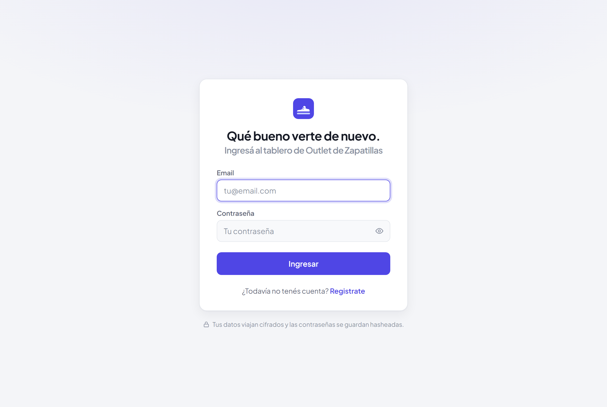

**Registro de usuario**

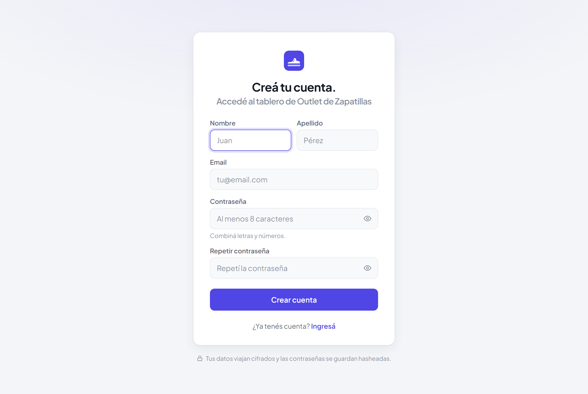

**Inicio de sesión con credenciales incorrectas**

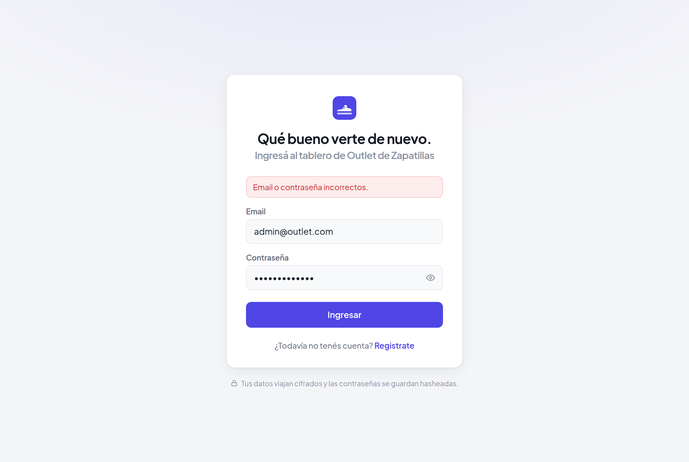

**Tablero luego de iniciar sesión**

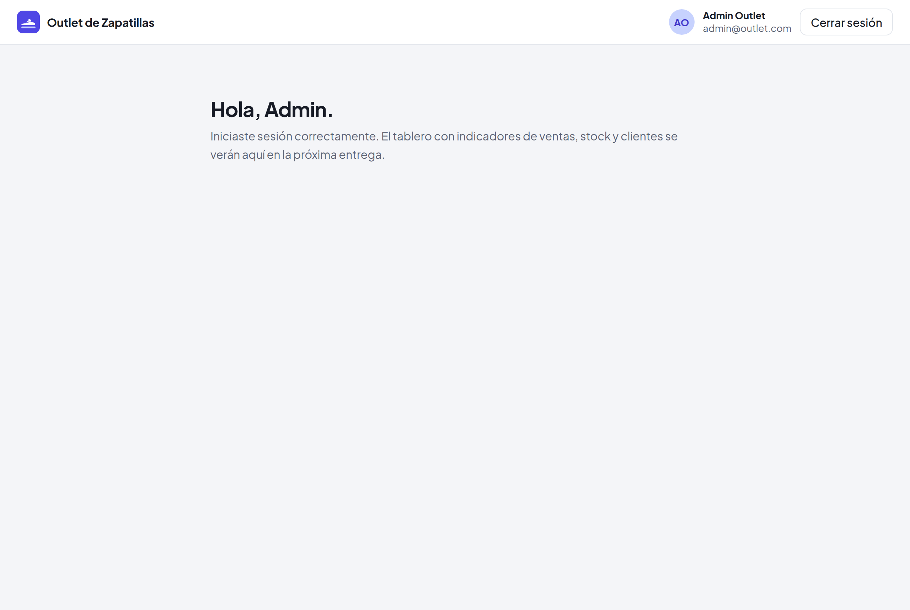

**Mockup: resumen con semáforo de objetivos**

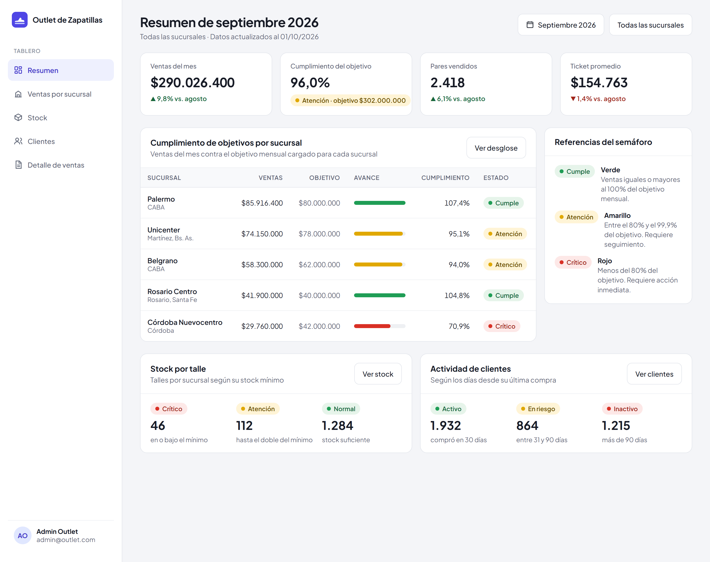

**Mockup: stock por talle**

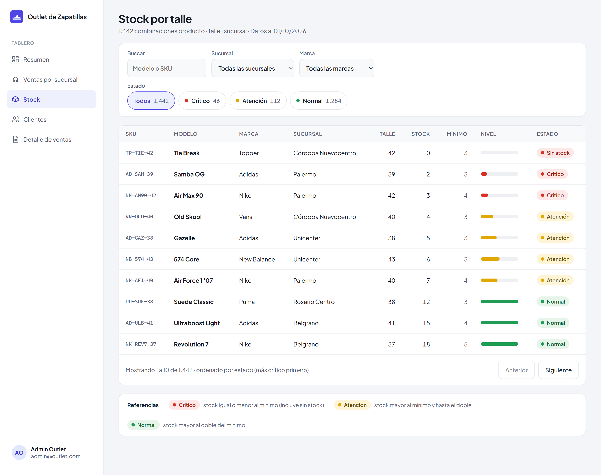

**Mockup: clientes**

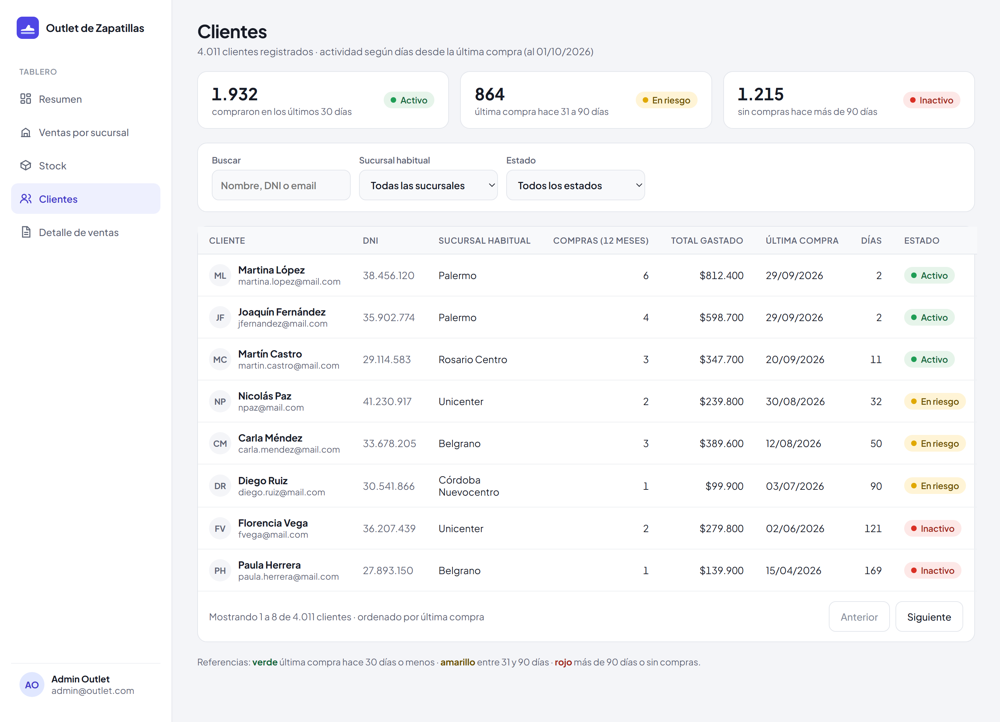

**Mockup: drill down por sucursal, marca, modelo y detalle**

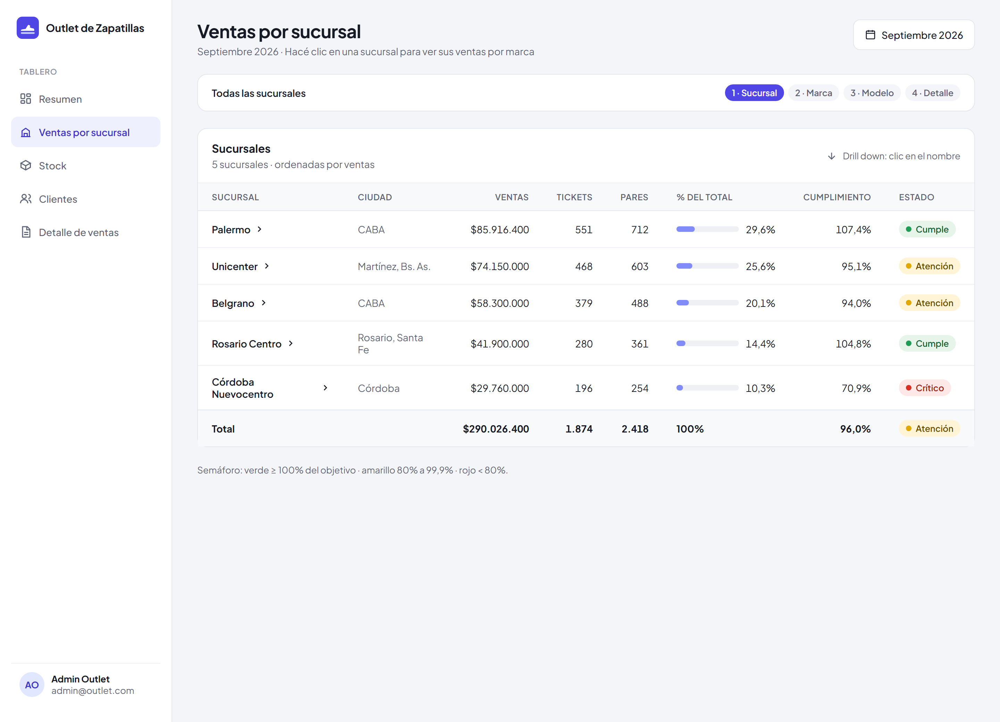

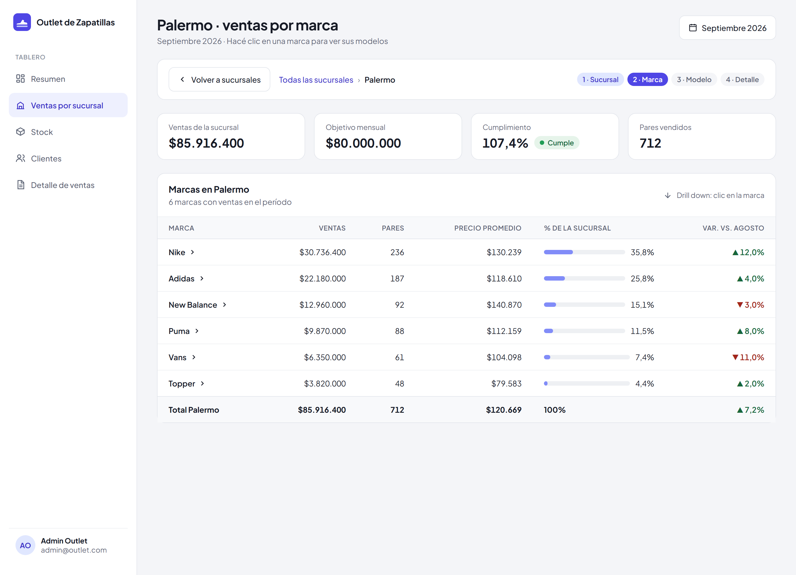

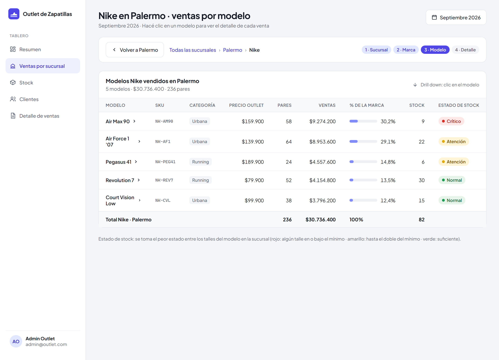

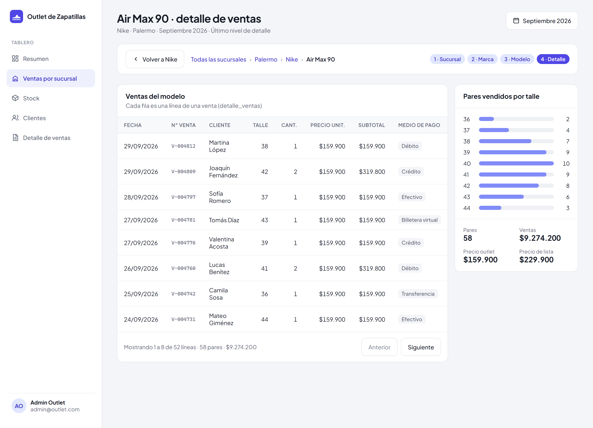

**Mockup: detalle de ventas**

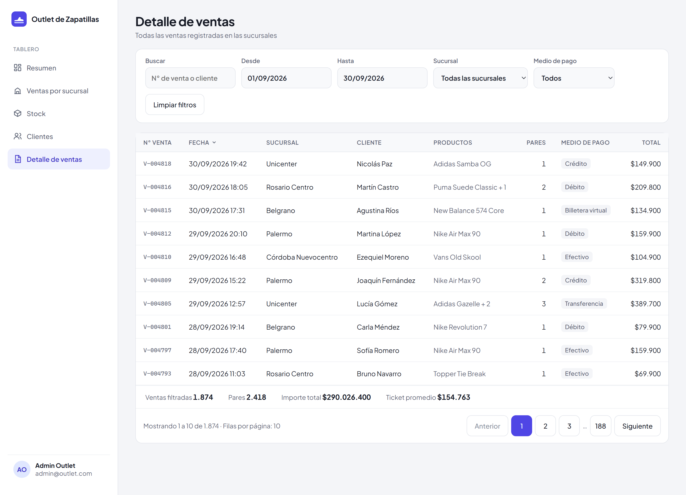

## Autores

**Leonel Maximiliano Blumberg**

**Luciano Galo Migoni**
