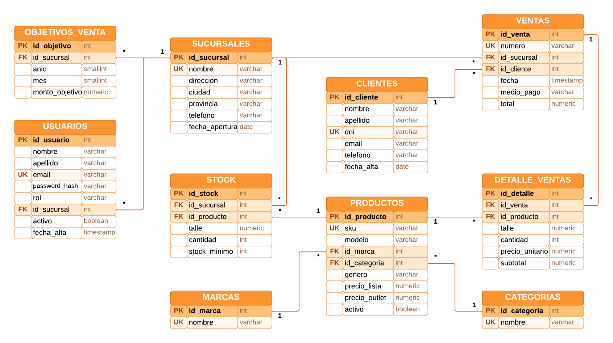

# Tablero de control · Outlet de Zapatillas

Trabajo cuatrimestral de **Bases de Datos Aplicada**. Dashboard web para una cadena de outlets de zapatillas con varias sucursales: ventas contra objetivo, stock por talle y actividad de clientes, con semaforización y drill down / drill up (Sucursal › Marca › Modelo › Detalle).

| Capa | Tecnología | Carpeta |
| --- | --- | --- |
| Frontend | React 19 + Vite + React Router | [`client/`](client/) |
| Backend | ASP.NET Core Web API (C#) | [`server/`](server/) |
| Base de datos | PostgreSQL | [`server/db/`](server/db/) |
| Documentación | Word, DER y mockups | [`docs/`](docs/) |

## Primera entrega

- [x] Documento inicial con DER y diccionario de datos: [`docs/Primera_Entrega_Outlet_de_Zapatillas.docx`](docs/Primera_Entrega_Outlet_de_Zapatillas.docx)
- [x] DER: [`docs/img/der.png`](docs/img/der.png) (Lucidchart)
- [x] Login y registro (frontend)
- [x] Mockups de semaforización, drill down / drill up y tablas: [`docs/img/mockups/`](docs/img/mockups/) y [Claude Design](https://claude.ai/artifact/2vPc2G4DkwdM5ZDvJAzNo7)
- [x] API de autenticación, conexión con PostgreSQL y siembra de usuarios (backend): [`server/`](server/)



## Cómo correr el proyecto

Requisitos: Node.js 20 o superior, .NET SDK 10 y PostgreSQL corriendo en `localhost:5432` (usuario `postgres`, contraseña `postgres`; para usar otra ver [`server/README.md`](server/README.md#configuración)).

**1. Backend** (crea la base `outlet_zapatillas`, las tablas y los usuarios de prueba la primera vez):

```bash
cd server/OutletApi
dotnet run
```

Queda en http://localhost:5000.

**2. Frontend**, en otra terminal:

```bash
cd client
npm install
npm run dev
```

Abre en http://localhost:5173. Entrar con alguno de los [usuarios de la siembra](#usuarios-de-la-siembra).

Vite redirige todas las llamadas a `/api` al backend (`VITE_API_PROXY_TARGET`), así que en desarrollo no hace falta configurar CORS.

## Contrato de la API de autenticación

El frontend consume estos endpoints ([`client/src/api/auth.js`](client/src/api/auth.js)). Todas las respuestas son JSON.

| Método | Ruta | Body | Respuesta OK | Errores |
| --- | --- | --- | --- | --- |
| `POST` | `/api/auth/login` | `{ "email", "password" }` | `200 { "token", "usuario" }` | `401 { "message": "Email o contraseña incorrectos." }`, `403 { "message" }` (cuenta deshabilitada), `400 { "message" }` |
| `POST` | `/api/auth/register` | `{ "nombre", "apellido", "email", "password" }` | `201 { "token", "usuario" }` | `409 { "message": "Ya existe una cuenta con ese email." }`, `400 { "message" }` |
| `GET` | `/api/auth/me` | Header `Authorization: Bearer <token>` | `200 usuario` | `401` |

`usuario` = `{ "id", "nombre", "apellido", "email", "rol" }`. Nunca se devuelve `password_hash`.

El frontend muestra el campo `message` de las respuestas de error tal cual, así que conviene escribirlo en castellano.

### Contraseñas

Se guardan con `PasswordHasher<T>` de ASP.NET Core Identity (PBKDF2 · HMAC-SHA512 con sal aleatoria y 100.000 iteraciones), no en texto plano ni con un SHA-256 sin sal:

```csharp
var hasher = new PasswordHasher<Usuario>();
usuario.PasswordHash = hasher.HashPassword(usuario, dto.Password);                // registro
var ok = hasher.VerifyHashedPassword(usuario, usuario.PasswordHash, dto.Password)
         != PasswordVerificationResult.Failed;                                   // login
```

Reglas de validación del registro, iguales en el frontend y en el backend: nombre y apellido de 2 a 60 caracteres, email válido y único de hasta 120 caracteres (se guarda en minúsculas), contraseña de 8 a 100 caracteres que combine letras y números.

### Usuarios de la siembra

Cuentas de prueba que crea [`server/db/02_siembra_usuarios.sql`](server/db/02_siembra_usuarios.sql) con la contraseña ya hasheada:

| Email | Contraseña | Rol |
| --- | --- | --- |
| `admin@outlet.com` | `Admin1234` | `admin` |
| `gerente@outlet.com` | `Gerente1234` | `gerente` |

Son credenciales solo para desarrollo.

## Modelo de datos

Tablas: `usuarios`, `sucursales`, `objetivos_venta`, `marcas`, `categorias`, `productos`, `stock`, `clientes`, `ventas`, `detalle_ventas`. Tipos, claves y restricciones de cada campo: sección 5 del documento.

## Semaforización

| Indicador | Verde | Amarillo | Rojo |
| --- | --- | --- | --- |
| Cumplimiento del objetivo mensual por sucursal | ≥ 100% | 80% a 99,9% | < 80% |
| Stock por producto · talle · sucursal | más del doble del mínimo | más del mínimo y hasta el doble | igual o menor al mínimo |
| Actividad de clientes (días desde la última compra) | ≤ 30 | 31 a 90 | > 90 o sin compras |
