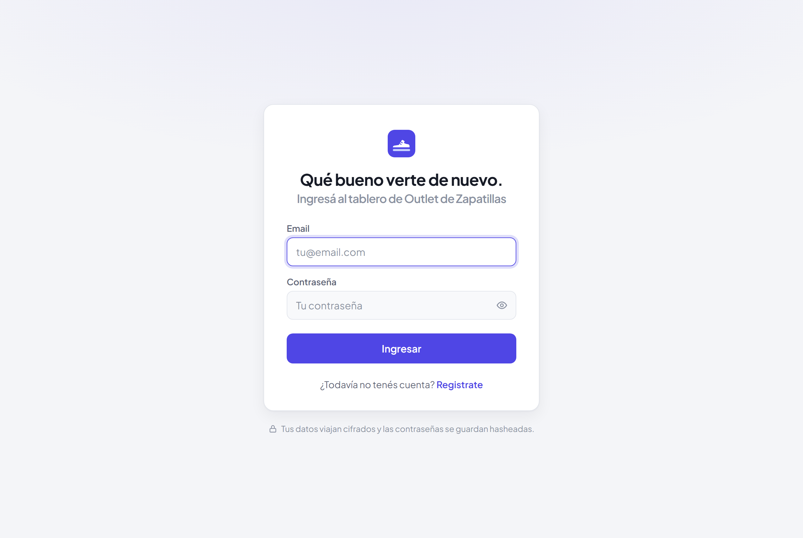
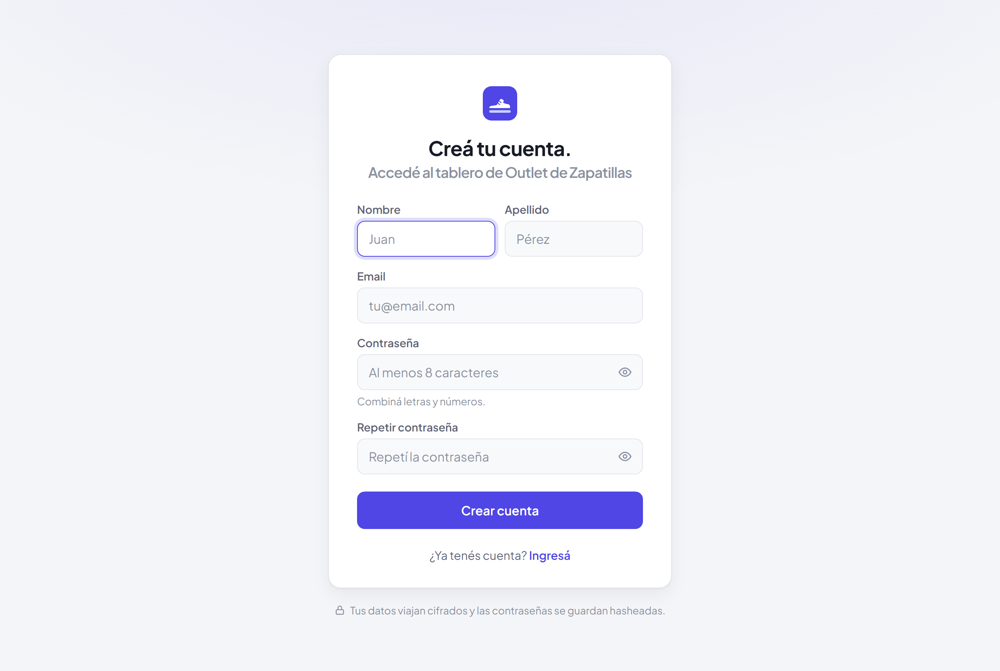
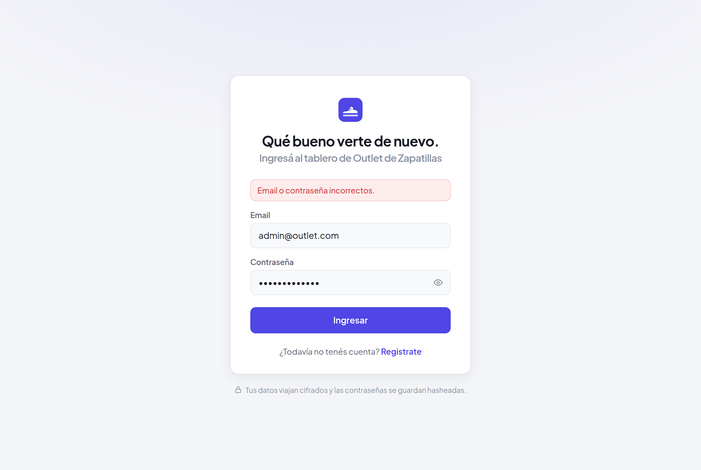
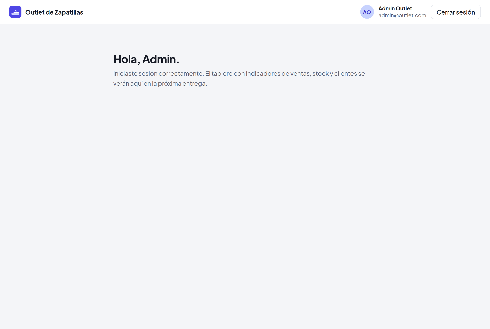

# Frontend del tablero de control

Interfaz web del tablero creada con **React 19**, **Vite** y **React Router**.
Se comunica por HTTP/JSON con la API de **ASP.NET Core** que está en
**`server/`**.

## Contenido

- **Pantallas**: inicio de sesión (**`/login`**), registro (**`/registro`**) y
  tablero (**`/tablero`**, pantalla de bienvenida).
- **Rutas protegidas**: el tablero solo se ve con sesión: login y registro,
  solo sin sesión. Cualquier otra ruta redirige a **`/tablero`** y, sin sesión,
  termina en **`/login`**.
- **Validaciones** de formularios con las mismas reglas que el backend.
- Estructura de **`src/`**:
  - **`api/`**: llamadas HTTP (**`http.js`**) y endpoints de autenticación
    (**`auth.js`**).
  - **`components/`**: layout de login y registro, campos de formulario y rutas
    protegidas.
  - **`context/`**: sesión del usuario con **`AuthProvider`** (login, registro y
    logout) y el hook **`useAuth`**.
  - **`pages/`**: **`LoginPage`**, **`RegisterPage`** y **`DashboardPage`**.
  - **`styles/`**: estilos globales y tokens de color.
  - **`utils/`**: validaciones de formularios.
  - **`config.js`**: nombre de la app, URL de la API y límites de los
    formularios.

## Requisitos previos

Para ejecutar el frontend se necesita:

- **Node.js 20** o superior.
- El **backend** corriendo (ver **`server/README.md`**), porque el login y el
  registro usan su API.

## Configuración local

- Frontend: **`http://localhost:5173`**
- **`VITE_API_PROXY_TARGET`**: backend al que Vite redirige **`/api`** en
  desarrollo. Por defecto, **`http://localhost:5000`**.
- **`VITE_API_URL`**: prefijo de la API para builds de producción. Por defecto,
  **`/api`**.

Para instalar las dependencias, ejecutar **`npm install`**. Luego, con
**`npm run dev`** se levanta el servidor de desarrollo, con **`npm run build`**
se genera la versión de producción y con **`npm run lint`** se revisa el código.

Para cambiar las variables sin tocar los archivos versionados, crear
**`.env.development.local`** (se puede copiar **`.env.example`**).

## Capturas

**Inicio de sesión**

**Registro de usuario**

**Inicio de sesión con credenciales incorrectas**

**Tablero luego de iniciar sesión**

## Autores

**Leonel Maximiliano Blumberg**

**Luciano Galo Migoni**
