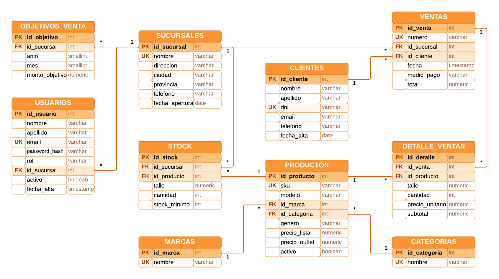

# Backend del tablero de control

API web creada con **ASP.NET Core** (C#, .NET 10) que valida el inicio de
sesión contra **PostgreSQL**. El acceso a datos es con **Npgsql** (ADO.NET), sin
ORM: cada consulta es SQL escrito a mano y parametrizado.

## Contenido

- **Endpoints de autenticación** (todas las respuestas son JSON):
  - **`POST /api/auth/login`**: recibe `{ email, password }` y devuelve
    `200 { token, usuario }`. Errores: `400` (datos incompletos), `401`
    (email o contraseña incorrectos) y `403` (cuenta deshabilitada).
  - **`POST /api/auth/register`**: recibe `{ nombre, apellido, email, password }`
    y devuelve `201 { token, usuario }`. Errores: `400` (datos inválidos) y
    `409` (ya existe una cuenta con ese email).
  - **`GET /api/auth/me`**: con el header `Authorization: Bearer <token>`
    devuelve el usuario. Sin un token válido responde `401`.
- **Usuario** que devuelve la API: `{ id, nombre, apellido, email, rol }`. Nunca
  se devuelve el **`password_hash`**.
- **Errores** con el formato `{ message }`, en castellano, para que el frontend
  los muestre tal cual.
- **Contraseñas** guardadas con **`PasswordHasher<Usuario>`** de ASP.NET Core
  Identity: PBKDF2 con HMAC-SHA512, sal aleatoria de 128 bits y 100.000
  iteraciones. La contraseña nunca se guarda ni se devuelve.
- **Validaciones del registro**, iguales a las del frontend: nombre y apellido
  de 2 a 60 caracteres, email válido y único de hasta 120 caracteres (se guarda
  en minúsculas) y contraseña de 8 a 100 caracteres que combine letras y
  números.
- **Scripts SQL** en **`base de datos/`**:
  - **`01_crear_tablas.sql`**: tablas del DER con sus PK, FK, UNIQUE y CHECK.
  - **`02_siembra_usuarios.sql`**: cuentas de prueba con la contraseña
    hasheada.
- Estructura de **`OutletApi/`**:
  - **`Controllers/AuthController.cs`**: endpoints de login, registro y sesión.
  - **`Data/UsuariosRepository.cs`**: consultas SQL sobre la tabla usuarios.
  - **`Data/DatabaseInitializer.cs`**: crea la base y ejecuta los scripts al
    arrancar.
  - **`Services/TokenService.cs`**: genera el token JWT.
  - **`Models/`** y **`Dtos/`**: fila de usuarios y cuerpos de la API.
  - **`Program.cs`**: configuración de la conexión, el JWT y el
    PasswordHasher.

## Requisitos previos

Para ejecutar el backend se necesita:

- **.NET SDK 10**.
- **PostgreSQL** (probado con las versiones 16 y 17) corriendo en
  **`localhost:5432`**.

Las tablas se crean ejecutando los scripts SQL de **`base de datos/`**: no se
usan migraciones ni **`dotnet ef database update`**.

## Configuración local

Valores de desarrollo, en **`OutletApi/appsettings.Development.json`**:

- Conexión (**`ConnectionStrings:Outlet`**):
  **`Host=localhost;Port=5432;Database=outlet_zapatillas;Username=postgres;Password=postgres`**
- Clave del JWT (**`Jwt:Key`**, 32 caracteres o más):
  **`clave-de-desarrollo-outlet-zapatillas`**
- Duración de la sesión (**`Jwt:ExpiraHoras`**): **`8`** horas
- API: **`http://localhost:5000`**

Para levantar la API, ejecutar **`dotnet run`** dentro de **`OutletApi`**. Al
arrancar, crea la base **`outlet_zapatillas`** si no existe y ejecuta
**`01_crear_tablas.sql`** y **`02_siembra_usuarios.sql`**, en orden y dentro de
una transacción. Los dos scripts se pueden correr varias veces sin duplicar
nada. Para no inicializar la base al arrancar, poner
**`Database:InicializarAlArrancar`** en **`false`**: los scripts también se
pueden ejecutar a mano desde psql o pgAdmin.

Si el usuario **`postgres`** tiene otra contraseña, no cambiar el archivo
versionado: usar los secretos de usuario de .NET, que quedan fuera del
repositorio. Para eso, ejecutar **`dotnet user-secrets init`** y luego
**`dotnet user-secrets set "ConnectionStrings:Outlet" "<cadena de conexión>"`**
con la contraseña correcta.

Para sembrar un usuario nuevo, generar el hash de su contraseña con
**`dotnet run -- hash <contraseña>`** y copiarlo en
**`base de datos/02_siembra_usuarios.sql`**.

Para probar la API sin el frontend, enviar un **`POST`** a
**`http://localhost:5000/api/auth/login`** con el cuerpo
**`{"email":"admin@outlet.com","password":"Admin1234"}`** (por ejemplo, con
curl o Postman).

## Capturas

**Diagrama entidad-relación de la base de datos**

## Autores

**Leonel Maximiliano Blumberg**

**Luciano Galo Migoni**
